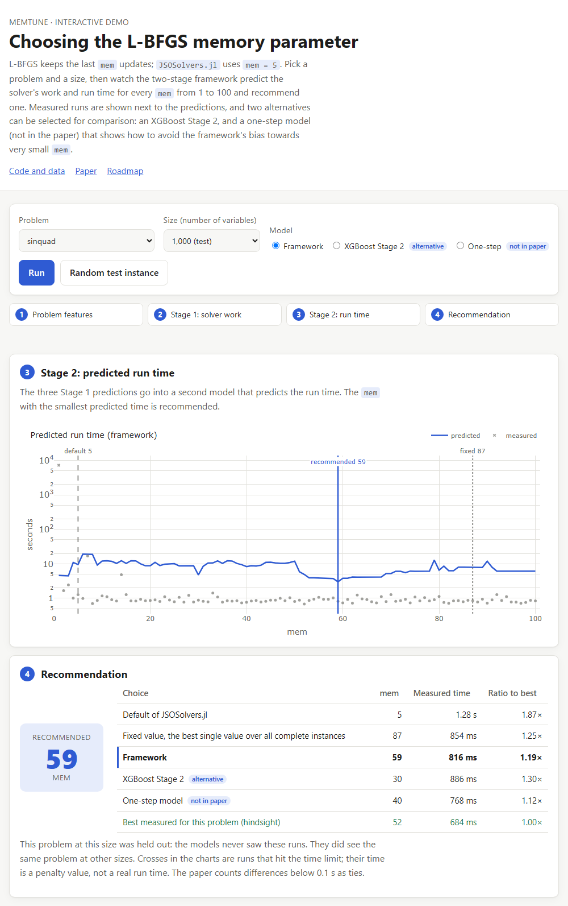

# memtune

**Choosing the L-BFGS memory parameter with machine learning: code, data and trained models of the paper.**

[](https://github.com/nishanmudalige/OptimizationParameterTuning/actions/workflows/tests.yml)
[](https://github.com/nishanmudalige/OptimizationParameterTuning/actions/workflows/pages.yml)
[](docs/INSTALL.md)
[](LICENSE)
[](https://doi.org/10.33137/codex.v2i1.47829)

L-BFGS has one setting that strongly affects its speed: the **memory** `mem`, the number of past updates it keeps.
[`JSOSolvers.jl`](https://github.com/JuliaSmoothOptimizers/JSOSolvers.jl) uses `mem = 5` for every problem. This
repository contains a two-stage statistical-learning framework that recommends `mem` for an unconstrained problem
from features that are cheap to compute, together with the benchmark it was built on (21,802 L-BFGS runs), the
trained models, and everything needed to reproduce the reported numbers on Linux, macOS and Windows.

> Y. Gao, *Leveraging High-Performance Scientific Computing for the Limited-Memory Hyperparameter Tuning of
> Large-Scale Unconstrained Continuous Optimization Solvers*, Journal of Computational and Data Exploration 2(1),
> 2026. [doi:10.33137/codex.v2i1.47829](https://doi.org/10.33137/codex.v2i1.47829)



## Contents

- [How it works](#how-it-works)
- [Installation](#installation)
- [Quick start](#quick-start)
- [Results](#results)
- [Interactive demo](#interactive-demo)
- [Reproducibility](#reproducibility)
- [Data and models](#data-and-models)
- [Repository layout](#repository-layout)
- [Limitations](#limitations)
- [Citation](#citation)
- [License, authors and contributing](#license-authors-and-contributing)

## How it works

1. **Stage 1** predicts, for a problem and a candidate `mem`, the number of objective and gradient evaluations
   (random forest) and the allocated memory (XGBoost) from 14 problem features and `mem`.
2. **Stage 2** turns those three predictions into a predicted run time (random forest).
3. The framework recommends the `mem` between 1 and 100 with the smallest predicted run time.

Each stage uses the model that was most accurate on the test set. Stage 1 is therefore a hybrid of two models, and
Stage 2 is a random forest (R² = 0.62 for the logarithm of the run time, against 0.57 for XGBoost).

The features describe the problem (number of variables, size and depth of the objective's expression tree, operator
counts) and the cost of one objective and one gradient evaluation. The solver itself is never run to make a
recommendation.

## Installation

You need [Git](https://git-scm.com/downloads) and Python **3.10, 3.11 or 3.12** (3.13 and newer are not supported,
because the pinned numpy has no build for them). The installer finds a suitable Python by itself, and tells you how
to get one if there is none.

```bash
git clone https://github.com/nishanmudalige/OptimizationParameterTuning.git
cd OptimizationParameterTuning
```

| System | Command |
|---|---|
| Linux, macOS, WSL, Git Bash | `./install.sh` |
| Windows PowerShell | `powershell -ExecutionPolicy Bypass -File install.ps1` |

The installer first prints a report of your system (operating system, processor, the Python versions it found, conda,
Docker, free disk space) and what it recommends. It then asks where to install (a private virtual environment in
`.venv`, a conda environment, or a Docker image) and which optional parts you want (notebooks, demo data, developer
tools, a full test run), shows the plan, and asks before it changes anything. At the end it checks the result.

```bash
./install.sh --detect               # only the system report and the recommendation
./install.sh --dry-run              # show the plan, change nothing
./install.sh --yes                  # no questions: the recommended setup
./install.sh --yes --with notebooks # ... plus JupyterLab
./install.sh --env docker           # build the Docker image instead; nothing is installed on your system
./install.sh --help                 # all options
```

It takes one to three minutes and about 600 MB of disk space, and writes only inside the repository folder.
Manual installation, conda, Docker, WSL and troubleshooting are described in [`docs/INSTALL.md`](docs/INSTALL.md).
To check an installation at any time, run `python -m memtune doctor`.

## Quick start

Activate the environment (`source .venv/bin/activate`, or `.venv\Scripts\Activate.ps1` on Windows), then:

```bash
python -m memtune reproduce                 # recompute the paper's results and compare them with the reference
python -m memtune demo                      # open the interactive demo in your browser
python -m memtune recommend problems.csv    # recommend mem for your own problems
python -m pytest                            # run the tests (about 3 minutes)
```

`recommend` reads a CSV file with one row per problem and the 14 feature columns listed in
[`docs/USAGE.md`](docs/USAGE.md), and adds a `recommended_mem` column. From Python:

```python
import pandas as pd
from memtune import recommend_mem

problems = pd.read_csv("problems.csv")
problems["recommended_mem"] = recommend_mem(problems)
```

| What | Command | Time |
|---|---|---|
| Recompute and verify the paper's results | `python -m memtune reproduce` | 5 s |
| Write the result tables to `results/` | `python -m memtune evaluate` | 5 s |
| Recommend `mem` for your problems | `python -m memtune recommend problems.csv` | 5 s |
| Interactive demo | `python -m memtune demo` | 10 s the first time |
| Check the installation | `python -m memtune doctor` | 5 s |
| Tests | `python -m pytest` | 3 min |
| Figures | `python scripts/plot_global_mem.py`, `python scripts/plot_per_problem.py --limit 5` | seconds |
| Compare model families | `python scripts/train_model_comparison.py --quick` | seconds (full sweep: hours) |
| Other train/test splits | `python scripts/robustness_check.py` | 3 min |
| Build the dataset from solver logs | `python scripts/build_dataset.py` | seconds |
| Notebooks | `./install.sh --with notebooks`, then `jupyter lab notebooks/` | 10 – 20 s each |

## Results

`python -m memtune reproduce` recomputes the following table from the committed models and data and checks all 32
values against a reference that was computed independently of this package.

The benchmark has 215 complete problem instances, each solved for `mem` = 1 … 100. An *instance* is a problem at one
size, also called a *configuration*. They were split once by instance: 172 for training and **43 for testing**
(seed 66). The *performance ratio* of a choice on an instance is its run time divided by the run time of
the best `mem` for that instance, so 1 is optimal. A choice within 0.1 s of the best counts as optimal.

| Choice of `mem` (43 test instances) | Median | 75th pct. | 90th pct. | Mean |
|---|---:|---:|---:|---:|
| Default `mem = 5` (Baseline 1) | 1.059 | 1.628 | 2.684 | 2.262 |
| Fixed `mem = 87` (Baseline 2) | 1.000 | 1.056 | 1.280 | 1.093 |
| **Framework** | 1.000 | 1.577 | 2.195 | 1.637 |

Baseline 2 is the single value with the smallest average run time over all 215 instances. It was chosen with
hindsight, so a user could not have known it in advance.

The framework improves on the default in these ratios, and a single large `mem` is a strong reference that it does
not beat. Whether choosing `mem` per problem adds anything beyond a larger fixed default is open.

**Alternative Stage 2.** The journal article also reports the framework with an XGBoost Stage 2 (90th percentile
2.061, mean 1.459). It is not part of the framework, because the random forest predicts the run time better, but its
model is kept so that those numbers stay reproducible: `python -m memtune reproduce` checks them, and
`--stage2 gb` selects it.

Two points go beyond the paper and are documented separately, so that the paper's numbers above stay exactly as
published:

- **The framework often recommends a very small `mem`**, and the total run time of its choices on the test instances
  is larger than with the default. [`docs/ONE_STEP_MODEL.md`](docs/ONE_STEP_MODEL.md) explains why and describes a
  one-step model, shipped with the package, that does not have this behaviour.
- **The results come from one split**, and every test instance is a problem that also occurs in the training data
  at another size. [`docs/ROBUSTNESS.md`](docs/ROBUSTNESS.md) describes how to repeat the evaluation on other splits
  and with whole problems held out.

## Interactive demo

```bash
python -m memtune demo
```

This computes the demo data from the committed models (10 seconds, only the first time), starts a local web server
and opens the page. Pick one of the 280 benchmark instances, press *Run*, and follow the stages: the problem's
features, the predicted solver work (Stage 1), the predicted run time for every `mem` (Stage 2) and the
recommendation, next to the measured runs, the default, the fixed value and the best measured `mem`. The page shows
the framework; the alternative XGBoost Stage 2 and the one-step model can be selected for comparison.

The page is static (`site/`). Every push to `main` builds and tests it, including a run in a real browser. It is
published at <https://nishanmudalige.github.io/OptimizationParameterTuning/> once GitHub Pages is switched on for the
repository (*Settings → Pages → Source: GitHub Actions*); until then, use the command above.
[`docs/DEMO_ROADMAP.md`](docs/DEMO_ROADMAP.md) describes the next step, computing the features of a new problem live.

## Reproducibility

| | |
|---|---|
| Exact environment | [`requirements-lock.txt`](requirements-lock.txt) pins every package; `python -m memtune doctor` compares your installation with it |
| One command | `python -m memtune reproduce` recomputes the results and marks every value `ok` or `DIFFERENT` |
| Independent reference | [`tests/golden/`](tests/golden) holds results computed by a script that re-implements the original notebooks without importing this package |
| Checksums | SHA-256 of the dataset ([`data/SHA256SUMS`](data/SHA256SUMS)) and of every model ([`models/SHA256SUMS`](models/SHA256SUMS)), verified by the tests |
| Continuous integration | every push runs the tests on Linux, macOS and Windows with Python 3.10 and 3.12, the installer on all three systems, and the Docker image |
| Container | `docker build -t memtune . && docker run --rm memtune python -m memtune reproduce` |

[`docs/REPRODUCING.md`](docs/REPRODUCING.md) lists each reported result with the command that produces it, where the
output goes and how long it takes. It also states what cannot be reproduced from this repository alone: the raw
measurements, which were collected with Julia scripts that are not included yet.

## Data and models

- **Data:** [`data/lbfgs_runs.csv.gz`](data/README.md) (1.9 MB, read directly; 98 MB unzipped). One row per L-BFGS
  run: 77 scalable unconstrained problems of
  [`OptimizationProblems.jl`](https://github.com/JuliaSmoothOptimizers/OptimizationProblems.jl) at 99 to 100,000
  variables, each for `mem` = 1 … 100, with a time limit of 3,600 s per run. All columns are documented in
  [`data/README.md`](data/README.md).
- **Models:** the framework's three models (two for Stage 1, one for Stage 2), the five other models compared with
  them in the paper, and the one-step model, in
  [`models/`](models/README.md). They are pickle files: load them only with the pinned versions (scikit-learn 1.5.1,
  **XGBoost 3.2.0**). Other XGBoost versions load the files but return wrong predictions, so `memtune` refuses to
  run with them. Only load pickle files from sources you trust.

## Repository layout

```
├── install.sh, install.ps1   the installer (system report, guided setup)
├── src/memtune/              the Python package: data, models, evaluation, recommendation, command line
├── scripts/                  dataset building, figures, model comparison, one-step model, robustness, demo data
├── notebooks/                the notebooks behind the paper (outputs cleared)
├── models/                   trained models with checksums
├── data/                     the dataset (compressed) and its documentation
├── site/                     the interactive demo (static page)
├── tests/                    regression tests, a small sample dataset, reference results
├── docs/                     INSTALL, USAGE, REPRODUCING, ONE_STEP_MODEL, ROBUSTNESS, DEMO_ROADMAP
└── results/                  everything the commands write (not in git)
```

## Limitations

- **One split, known problems.** All reported numbers come from a single train/test split of 215 instances, and the
  test instances are new sizes of problems seen in training, not new problems.
- **Small `mem`.** The framework's Stage 2 tends to predict a longer run for a larger `mem`, so it often picks
  `mem` ≤ 3 ([details](docs/ONE_STEP_MODEL.md)).
- **Scope.** The data covers scalable unconstrained problems of `OptimizationProblems.jl`, 99 to 100,000 variables,
  and L-BFGS of `JSOSolvers.jl`. Recommendations for other problems or solvers are extrapolations.
- **Machine-dependent features.** Three of the features are timings measured on the machine that collected the
  data; on another machine they will differ.
- **Failed runs.** Runs that reached the time limit carry a penalty time of 7,200 s
  ([`data/README.md`](data/README.md#failed-runs)).
- **Data collection is not included.** The Julia scripts that ran the solver are not in this repository yet, so the
  dataset itself cannot be regenerated from here.

## Citation

If you use this code, the data or the models, please cite the paper. GitHub's *Cite this repository* button gives
the same entry from [`CITATION.cff`](CITATION.cff).

```bibtex
@article{gao2026memtune,
  author  = {Gao, Yuchen},
  title   = {Leveraging High-Performance Scientific Computing for the Limited-Memory Hyperparameter Tuning of
             Large-Scale Unconstrained Continuous Optimization Solvers},
  journal = {Journal of Computational and Data Exploration},
  volume  = {2},
  number  = {1},
  year    = {2026},
  doi     = {10.33137/codex.v2i1.47829}
}
```

## License, authors and contributing

Released under the [MIT License](LICENSE). Authors: Yuchen (Felix) Gao, Tangi Migot and Nishan Mudalige (Gao and
Mudalige: University of Toronto Mississauga).

The data was collected with the [JuliaSmoothOptimizers](https://juliasmoothoptimizers.github.io/) ecosystem
(`JSOSolvers.jl`, `OptimizationProblems.jl`, `ADNLPModels.jl`).

Questions and problems: please open an [issue](https://github.com/nishanmudalige/OptimizationParameterTuning/issues).
[`CONTRIBUTING.md`](CONTRIBUTING.md) explains how to set up a development environment and what a change must pass;
[`CHANGELOG.md`](CHANGELOG.md) lists what changed between versions.
